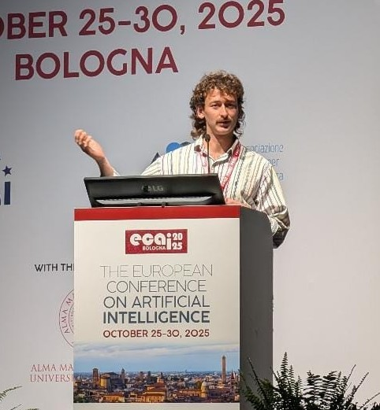

  

  

    <h1>Gwen Maudet</h1>

    

      Postdoctoral Researcher 
      <a href="https://www.uni.lu/snt-en/">University of Luxembourg</a> ·
      <a href="https://www.uni.lu/snt-en/research-groups/pcog/">SnT · PCOG</a>
    

    

      I work at the intersection of mathematical optimization, machine
      learning, and algorithm design, with applications to industrial
      optimization and networking problems.
    

    

      <a href="mailto:gwen.maudet@gmail.com">✉ Email</a>
      <a href="https://orcid.org/0000-0003-0340-2542">◉ ORCID</a>
      <a href="https://www.linkedin.com/in/gwen-maudet-1a1490171/">in LinkedIn</a>
      <a href="cv_gwen_maudet.pdf">↓ CV (PDF)</a>
    

  

  
Research profile

  

    Mathematical modelling · Combinatorial optimization · Machine learning
    for exact solvers · MILP instance similarity · Massive IoT
  

<section id="experience" class="page-section">
  <h2>Experience &amp; Education</h2>

  

    <article class="experience-item current">
      
Dec. 2023 — Present

      

        <h3>Postdoctoral Researcher</h3>
        
University of Luxembourg · SnT · Esch-sur-Alzette, Luxembourg

        

          <strong>Machine learning for Mixed-Integer Linear Programming.</strong>
          Developing learning-based strategies for exact optimization solvers,
          studying generalization across heterogeneous MILP instances, and
          formulating networking and industrial optimization problems.
        

        

          Teaching Master's students, supervising research projects, and
          co-supervising PhD research within the
          <a href="https://danoy.gforge.uni.lu/project/ultrabo/">Ultra Big Optimization</a>
          project.
        

      

    </article>

    <article class="experience-item">
      
2020–2023

      

        <h3>PhD in Computer Science</h3>
        
IMT Atlantique · Rennes, France

        

          <strong>Exploiting Sensor Similarity to Enhance Data Collection in Massive IoT Networks.</strong>
          Research on sensor similarity, energy-efficient data collection,
          message scheduling, and redundancy reduction in large-scale IoT
          networks.
        

        

          <a href="https://hal.science/tel-04349604v1">PhD thesis</a> ·
          <a href="https://youtu.be/0p3jmufFM1k?si=zH99MpST1HHMHA3K&amp;t=2520">PhD defense video</a>
        

      

    </article>

    <article class="experience-item">
      
Apr. — Sep. 2020

      

        <h3>Research Intern</h3>
        
Inria · Rennes, France

        

          <strong>Detecting bias in search engines.</strong>
          Developed bias-detection tools and contributed to the
          <a href="https://snide.irisa.fr">SNIDE</a> platform.
        

      

    </article>

    <article class="experience-item">
      
2016–2020

      

        <h3>Engineering Degree</h3>
        
IMT Atlantique · Nantes, France

        
Computer Science for Decision Support.

        

          Focus on computer science, machine learning, mathematical
          optimization, and graph-based methods.
        

      

    </article>

    <article class="experience-item">
      
Jun. — Aug. 2019

      

        <h3>Research Intern</h3>
        
Acklio · Rennes, France

        

          <strong>Header compression for IoT networks.</strong>
          Developed clustering-based methods to identify similarities
          between transmission headers and generate compression rules
          based on RFC 8724.
        

      

    </article>

    <article class="experience-item">
      
2014–2016

      

        <h3>Intensive Preparatory Program for Engineering Schools</h3>
        
Lycée Rabelais · MPSI → MP · France

      

    </article>

  

</section>

<section id="research" class="page-section">
  <h2>Research</h2>

  

    

      

        <h3>Machine Learning for Mixed-Integer Linear Programming</h3>
        

          Postdoctoral research on machine learning for exact optimization
          solvers, with a focus on:
        

        <ul>
          <li>
            <strong>Interpretable ML strategies</strong> for solver components,
            including branching, lower-bound computation, and cutting-plane
            selection.
          </li>
          <li>
            <strong>MILP instance similarity and portfolios</strong> to improve
            the generalization of learning-based solving strategies across
            heterogeneous instances.
          </li>
          <li>
            <strong>Mathematical modelling</strong> of networking and
            industrial optimization problems.
          </li>
        </ul>
      

    

    

      

        <h3>Sensor Networks &amp; IoT</h3>
        

          PhD research on data collection in large-scale Massive IoT networks,
          focusing on:
        

        <ul>
          <li>
            <strong>Sensor similarity</strong> based on sensing data and
            transmission characteristics.
          </li>
          <li>
            <strong>Energy-efficient monitoring</strong> through scheduling
            and communication redundancy reduction.
          </li>
        </ul>
      

    

  

</section>

<section id="publications" class="page-section">
  <h2>Publications &amp; Research Output</h2>

  <h3>International Journals</h3>
  <ul>
    <li>
      P. Maillé, <strong>G. Maudet</strong>, M. Simon, B. Tuffin,
      “Are Search Engines Biased? Detecting and Reducing Bias using Meta
      Search Engines,” <em>Electronic Commerce Research and Applications</em>,
      2022.
      <a href="https://doi.org/10.1016/j.elerap.2022.101132">DOI</a>
    </li>
  </ul>

  <h3>International Conferences</h3>
  <ul>
    <li>
      A. Vorokhta, <strong>G. Maudet</strong>, G. Danoy,
      “Selecting the Best Lower-Bound Strategy in a Branch-and-Bound Algorithm
      Using Genetic Programming,”
      <em>International Workshop on Big Optimization</em>, 2026.
      <a href="https://link.springer.com/chapter/10.1007/978-3-032-15455-2_4">Link</a>
    </li>
    <li>
      <strong>G. Maudet</strong>, G. Danoy,
      “A Distance Metric for Mixed Integer Programming Instances,”
      <em>European Conference on Artificial Intelligence</em>, 2025.
      <a href="https://ebooks.iospress.nl/doi/10.3233/FAIA250894">Link</a>
    </li>
    <li>
      <strong>G. Maudet</strong>, G. Danoy,
      “Search Strategy Generation for Branch and Bound Using Genetic
      Programming,” <em>AAAI</em>, 2025.
      <a href="https://ojs.aaai.org/index.php/AAAI/article/view/33229">Link</a>
    </li>
    <li>
      <strong>G. Maudet</strong>, M. Batton-Hubert, P. Maillé, L. Toutain,
      “Energy Efficient Message Scheduling with Redundancy Control for Massive
      IoT Monitoring,” <em>IEEE WCNC</em>, 2023.
      <a href="https://ieeexplore.ieee.org/abstract/document/10118910">Link</a>
    </li>
    <li>
      <strong>G. Maudet</strong>, M. Batton-Hubert, P. Maillé, L. Toutain,
      “Emission Scheduling Strategies for Massive-IoT: Implementation and
      Performance Optimization,” <em>IEEE/IFIP NOMS</em>, 2022.
      <a href="https://ieeexplore.ieee.org/document/9789769">Link</a>
    </li>
  </ul>

  <h3>Extended Abstracts &amp; National Conferences</h3>
  <ul>
    <li>
      M. Da Cunha, <strong>G. Maudet</strong>, G. Danoy,
      “Cutting Plane Selection for Mixed-Integer Linear Programming Using
      Genetic Programming,” Extended Abstract,
      <em>Conference on Optimisation and Learning</em>, 2026.
    </li>
    <li>
      B. Blé, <strong>G. Maudet</strong>, G. Danoy,
      “Distance-based Portfolio Learning for Mixed-Integer Programming,”
      Extended Abstract, <em>Conference on Optimisation and Learning</em>, 2026.
    </li>
    <li>
      <strong>G. Maudet</strong>, G. Danoy,
      “Une Distance pour les Instances de Programmation Linéaire en Nombres
      Entiers Mixtes,” <em>ROADEF</em>, 2026.
    </li>
    <li>
      <strong>G. Maudet</strong>, G. Danoy,
      “A Distance Metric for Mixed Integer Programming Instances,”
      <em>ORBEL</em>, 2026.
    </li>
    <li>
      A. Vorokhta, <strong>G. Maudet</strong>, G. Danoy,
      “Generating LB Computation Strategies in a B&amp;B Algorithm: Application
      to the PFSP,” Extended Abstract,
      <em>Conference on Optimisation and Learning</em>, 2025.
    </li>
    <li>
      <strong>G. Maudet</strong>, M. Batton-Hubert, P. Maillé, L. Toutain,
      “Grouper les Capteurs Similaires Grâce à leurs Données dans le Contexte
      de Massive IoT,” <em>ALGOTEL</em>, 2024.
      <a href="https://hal.science/hal-04549902v1">HAL</a>
    </li>
    <li>
      <strong>G. Maudet</strong>, M. Batton-Hubert, P. Maillé, L. Toutain,
      “Réduction de la Redondance de Messages des Capteurs dans un Contexte
      Massive IoT,” <em>ALGOTEL</em>, 2023.
      <a href="https://hal.science/hal-04079906">HAL</a>
    </li>
  </ul>

  <h3>Preprint</h3>
  <ul>
    <li>
      <strong>G. Maudet</strong>, M. Batton-Hubert, P. Maillé, L. Toutain,
      “Grouping Sensors Based on Observations in a Massive IoT Deployment.”
      <a href="https://hal.science/hal-04424455v4">HAL</a>
    </li>
  </ul>

  <h3>Ongoing Work</h3>
  <ul>
    <li>
      “Adaptive Lower Bound Evaluation for the Permutation Flowshop Scheduling
      Problem,” with Alisa Vorokhta. <em>Under review.</em>
    </li>
    <li>
      “SkyHOSTop: Cost-Aware Multi-Cloud Streaming Overlay Optimization,”
      with Muhammad Arslan Tariq. <em>Under review.</em>
    </li>
    <li>
      “Cutting Plane Selection for Mixed-Integer Linear Programming Using
      Genetic Programming,” with Mathis Da Cunha. <em>Under review.</em>
    </li>
    <li>
      “Performance Driven Portfolio Approach to Generalize Machine Learning
      for Mixed Integer Programming.” <em>In progress.</em>
    </li>
    <li>
      “Distance Based Clustering of the Mixed-Integer Programming Space for
      Portfolio-Based Machine Learning Generalization,” with Baka Junior
      Cedric Blé. <em>In progress.</em>
    </li>
  </ul>

  <h3>PhD Thesis</h3>
  

    <strong>Exploiting Sensor Similarity to Enhance Data Collection in Massive
    IoT Networks</strong> 
    <a href="https://hal.science/tel-04349604v1">Thesis on HAL</a> ·
    <a href="https://youtu.be/0p3jmufFM1k?si=zH99MpST1HHMHA3K&amp;t=2520">PhD defense video</a>
  

  <h3>Research Mentors</h3>
  <ul>
    <li>
      <a href="https://www.imt-atlantique.fr/fr/personne/patrick-maille">Prof. Patrick Maillé</a>
      — PhD supervisor, IMT Atlantique / IRISA.
    </li>
    <li>
      <a href="https://www.imt-atlantique.fr/fr/personne/laurent-toutain">Prof. Laurent Toutain</a>
      — PhD director, IMT Atlantique / IRISA.
    </li>
    <li>
      <a href="https://danoy.gforge.uni.lu/">Prof. Grégoire Danoy</a>
      — Postdoctoral mentor, University of Luxembourg / SnT.
    </li>
  </ul>
</section>

<section id="teaching" class="page-section">
  <h2>Teaching</h2>

  

    Teaching across mathematical foundations, theoretical computer science,
    optimization algorithms, and computational methods, connecting theory
    with practical problem solving.
  

  

    

      
Mathematical Foundations

      

        Algebra
        Probability &amp; Statistics
        Signal Processing
      

    

    

      
Optimization Algorithms

      

        MILP
        Branch &amp; Bound
        Branching &amp; Search
        Population-Based Algorithms
      

    

    

      
Computational Practice

      

        Python
        MATLAB
        Data Science
        SCIP
        DEAP
        Jupyter Notebooks
      

    

  

  <h3>University of Luxembourg · 2024–2025</h3>

  

    <strong>Project supervision:</strong> Semester-long projects with teams
    of three Master's students, around four hours of group work per week.
  

  <ul>
    <li>
      <strong>2024</strong> — Lower-bound strategies in Branch &amp; Bound
      for the Permutation Flowshop Problem.
    </li>
    <li>
      <strong>2025</strong> — Cutting-plane selection in Branch &amp; Bound.
    </li>
  </ul>

  

    <strong>Lectures:</strong> Master's students in Information and Computer
    Sciences.
  

  <ul>
    <li><strong>Winter 2024:</strong> 4 × 1.5-hour lectures · 58 students.</li>
    <li><strong>Winter 2025:</strong> 6 × 1.5-hour lectures · 62 students.</li>
  </ul>

  
<strong>Lecture resources:</strong>

  <ul>
    <li>
      Introduction to Branch &amp; Bound —
      <a href="/teaching/2025-intro_to_B_and_B.pdf">Slides</a>
    </li>
    <li>
      Searching and Branching in Branch &amp; Bound —
      <a href="/teaching/2025-searching_and_branching.pdf">Slides</a>
    </li>
    <li>
      Population-Based Algorithms —
      <a href="/teaching/2025-population_based_algorithms.pdf">Slides</a>
    </li>
    <li>
      Travelling Salesman Problem —
      <a href="/teaching/2025-TSP_exercice.ipynb">Exercises</a> ·
      <a href="/teaching/2025-TSP_correction.ipynb">Correction</a>
    </li>
  </ul>

  <h3>IMT Atlantique · Rennes · 2022–2023</h3>

  

    Practice teaching in the international Master's program in Information
    Technology.
  

  <ul>
    <li><strong>2022:</strong> 49 hours · 12 students.</li>
    <li><strong>2023:</strong> 40 hours · 24 students.</li>
  </ul>

  

    <strong>Topics:</strong> Algebra, probability and statistics, Python,
    data science, MATLAB, signal processing, operations research and
    problem solving.
  

</section>

<section id="supervision" class="page-section">
  <h2>Supervision</h2>

  <h3>PhD Students</h3>
  <ul>
    <li>
      <strong>2026–Present · Simon Renard</strong> — Enhancing solver
      branching strategies through machine learning.
    </li>
    <li>
      <strong>2026–Present · Muhammad Arslan Tariq</strong> — Streaming
      through multi-cloud, multi-path connections; path optimization using
      MILP formulations.
    </li>
    <li>
      <strong>2023–Present · Alisa Vorokhta</strong> — Machine learning for
      improving lower-bound computation.
    </li>
  </ul>

  <h3>Interns</h3>
  <ul>
    <li>
      <strong>2025 · Baka Junior Cedric Blé</strong> — Clustering the
      mixed-integer programming space; 5 months.
    </li>
    <li>
      <strong>2025 · Mathis Da Cunha</strong> — Cutting-plane selection in
      Branch &amp; Bound; 5 months.
    </li>
    <li>
      <strong>2022 · Issam Belhorma</strong> — Kriging techniques for sensor
      position estimation; 5 months.
    </li>
    <li>
      <strong>2021 · Carlos Delgado</strong> — Sensor deployment in green
      walls; 3 months.
    </li>
  </ul>

  <h3>Student Projects &amp; Jobs</h3>
  <ul>
    <li>
      <strong>2025 · Diptaraj Sen</strong> — Evaluating instance benchmarks
      using distances between optimization instances; 3 months, 5 h/week.
    </li>
    <li>
      <strong>2024 · Daniele Ferrario</strong> — Understanding a
      reinforcement-learning framework for cutting-plane selection;
      5 months, 5 h/week.
    </li>
  </ul>
</section>

<section id="service" class="page-section">
  <h2>Reviewing &amp; Service</h2>

  <ul>
    <li>
      <strong>Shadow PC Chair</strong> — ALGOTEL-Cores 2025; reviewer
      recruitment, review methodology, and paper discussions.
    </li>
    <li>
      <strong>Reviewer</strong> — IEEE Transactions on Network and Service
      Management, IEEE Sensors Journal, and IPDPS Workshop; shadow reviewer
      for ALGOTEL/Cores.
    </li>
  </ul>

  <h3>Academic Service &amp; Associations</h3>
  <ul>
    <li>
      <strong>President</strong>, Association of PhD Students and Young
      Researchers, IMT Atlantique Rennes · 2022–2023.
    </li>
    <li>
      <strong>PhD Student Representative</strong>, SPIN Doctoral School,
      IMT Atlantique Rennes · 2023.
    </li>
  </ul>
</section>

<section id="interests" class="page-section">
  <h2>Other Interests</h2>

  <ul class="hobby-list">
    <li>
      🌱 <strong>Gardening &amp; permaculture</strong> — From seed to fruit,
      including edible and inedible plants, flowering plants, and anything
      else that happens to grow.
    </li>
    <li>
      🫙 <strong>Fermentation &amp; experimental cooking</strong> — Kombucha,
      lacto-fermented vegetables, homemade vinegar from
      <em>questionably old</em> alcohol.
    </li>
    <li>
      🧗 <strong>Sports</strong> — Indoor and outdoor bouldering, rope
      climbing, trail running and hiking, cyclotourism, and a black belt
      in judo.
    </li>
    <li>
      🎵 <strong>Music</strong> — Post-punk, rap, indie rock, and French
      <em>variété</em>.
    </li>
  </ul>
</section>

<a href="#top">↑ Back to top</a>

